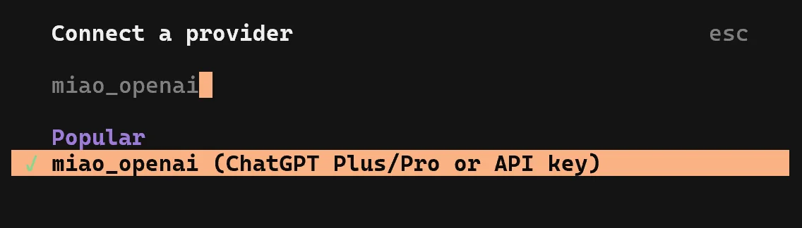
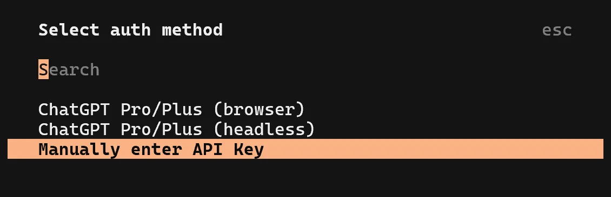
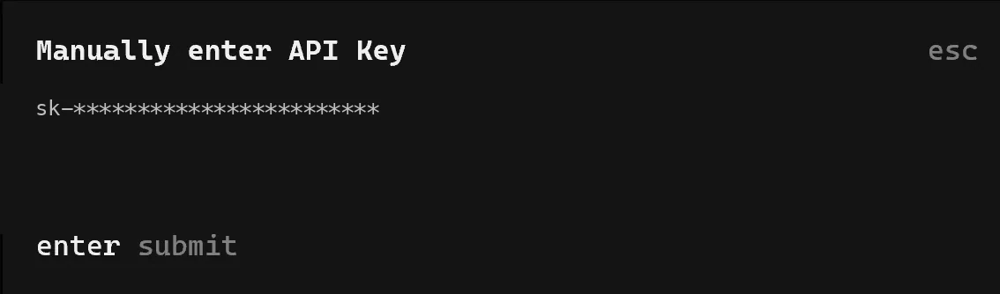
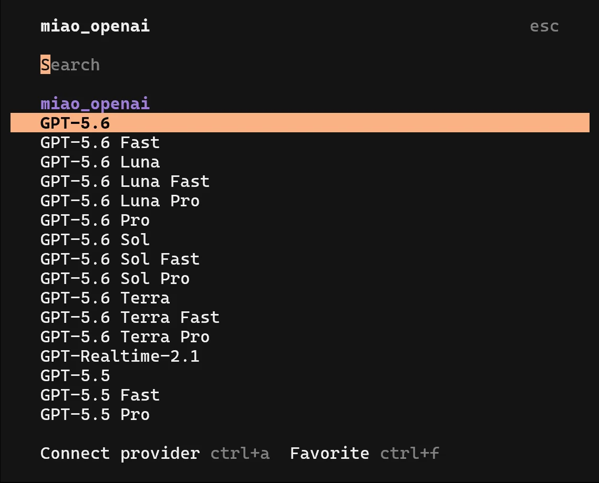
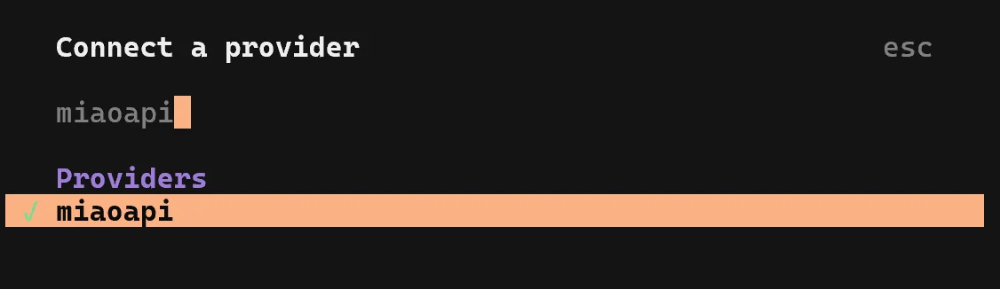
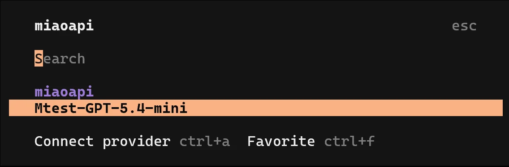
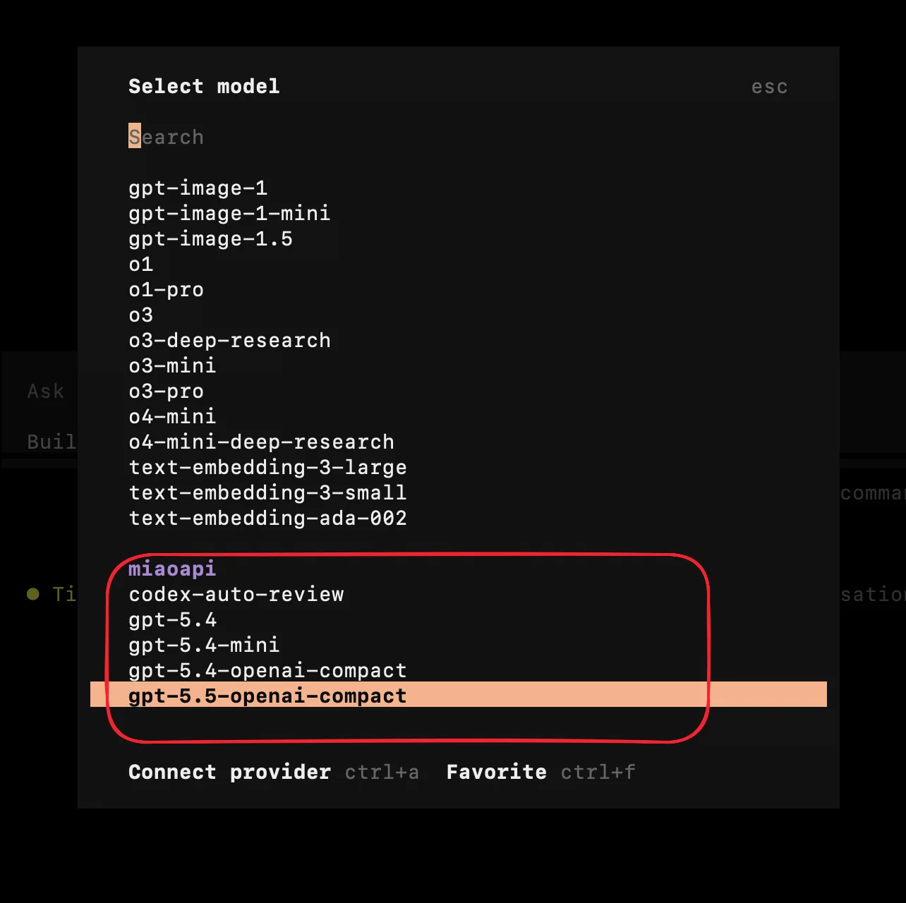

# 在 OpenCode 中配置

OpenCode 通过 provider 接入 MiaoAPI。配置文件位于 `~/.config/opencode/opencode.json`（或 `opencode.jsonc`），Windows 下的用户目录通常为 `C:\Users\{user_name}`。

把以下内容中的your-api-key替换成你的密钥，然后按说明编写配置文件即可。配置文件路径：~/.config/opencode/opencode.json（或 opencode.jsonc）。

（`~` 代表用户目录，Windows 下通常为 `C:\Users\{user_name}`）

Opencode的配置主要是配置provider，有两种配置方式。下面的配置文件中用gpt-5.4-mini这个比较便宜的模型作为测试模型，方法二请按后面旧的说明文件以及官方模型名修改配置。

## 推荐配置：继承官方 OpenAI 配置

【推荐方法，Grok模型类比这个替换xai的就好了】一是替换openai官方的，会默认继承官方所有配置内容，包括模型列表、模型的推理强度选项、缓存机制、端点等。将下面"openai":{ ... },这一部分填入"provider"即可。填写好后，打开opencode，/connect并搜索miao_openai（即"name"后面所用的名字，可以改成自己喜欢的），点击进入，Select auth method选择Manually enter API Key，填入你的miaoapi并回车，然后选择合适的模型就可以开始用啦，因为用了官方配置，所以还会再选一下推理强度。注意不是所有模型都支持，不要用Fast、Pro后缀的模型以及过老的模型。









二是自定义模型提供商，即"miaoapi":{ ... }这一部分内容。这种配置方式下所有模型需要手动输入，格式为全部小写，然后配置一个"name"就可以进行最基本的使用，如果需要配置推理强度等，需要额外添加其它字段，可以参考官方文档和后面的配置文件写法。示例里给出了三档推理强度的配置方法，其中high给出了较为完整的可定义字段（实测这三项不配置，以及textVerbosity调整low/medium/high对输出、缓存命中、推理摘要均无明显影响）。其中apiKey可以就用下面的方式指定，也可以同上在改好配置后，/connect 搜索 "name" 对应的 "miaoapi"，然后输入apiKey，程序会自动写入auth.json文件完成配置。配置好后就会弹出现在已经写在opencode.json中的模型列表。

其中"npm": "@ai-sdk/openai"对应端点为"/v1/responses"，"@ai-sdk/openai-compatible"对应端点为"/v1/chat/completions"，推荐使用responses的。






```json
{
  "$schema": "https://opencode.ai/config.json",
  "provider": {
    "openai": {
      "name": "miao_openai",
      "options": {
        "baseURL": "https://miaoapi.site/v1"
      },
      "models": {
        "gpt-5.4-mini": {
          "name": "Miao-GPT-5.4-mini"
        }
      }
    },
    "miaoapi":{
      "npm": "@ai-sdk/openai",
      "name": "miaoapi",
      "options":{
        "baseURL": "https://miaoapi.site/v1",
        "setCacheKey": true,
        "apiKey": "your-api-key"
      },
      "models": {
        "gpt-5.4-mini": {
          "name": "Mtest-GPT-5.4-mini",
          "variants": {
            "low": {
              "reasoningEffort": "low"
            },
            "medium": {
              "reasoningEffort": "medium"
            },
            "high": {
              "reasoningEffort": "high",
              "textVerbosity": "low",
              "reasoningSummary": "auto",
              "include": ["reasoning.encrypted_content"]
            }
          }
        }
      }
    }
  }
}
```


## 旧版配置：自定义 provider

【旧版说明】把以下内容中的your-api-key替换成你的密钥（注意有两处），然后替换配置文件即可。配置文件路径：~/.config/opencode/opencode.json（或 opencode.jsonc）。

注意：打开opencode之后记得输入/models，找到miaoapi后缀的gpt系列模型，不要选到官方模型去了。

```json
{
  "$schema": "https://opencode.ai/config.json",
  "provider": {
    "miaoapi": {
      "models": {
        "codex-auto-review": {
          "name": ""
        },
        "gpt-5.4": {
          "name": ""
        },
        "gpt-5.4-mini": {
          "name": ""
        },
        "gpt-5.5": {
          "name": ""
        }
      },
      "npm": "@ai-sdk/openai-compatible",
      "options": {
        "apiKey": "your-api-key",
        "baseURL": "https://miaoapi.site/v1",
        "setCacheKey": true
      }
    },
    "openai": {
      "models": {
        "codex-mini-latest": {
          "limit": {
            "context": 200000,
            "output": 100000
          },
          "name": "Codex Mini",
          "options": {
            "store": false
          },
          "variants": {
            "high": {},
            "low": {},
            "medium": {}
          }
        },
        "gpt-5.2": {
          "limit": {
            "context": 400000,
            "output": 128000
          },
          "name": "GPT-5.5",
          "options": {
            "store": false
          },
          "variants": {
            "high": {},
            "low": {},
            "medium": {},
            "xhigh": {}
          }
        },
        "gpt-5.3-codex": {
          "limit": {
            "context": 400000,
            "output": 128000
          },
          "name": "GPT-5.3 Codex",
          "options": {
            "store": false
          },
          "variants": {
            "high": {},
            "low": {},
            "medium": {},
            "xhigh": {}
          }
        },
        "gpt-5.3-codex-spark": {
          "limit": {
            "context": 128000,
            "output": 32000
          },
          "name": "GPT-5.3 Codex Spark",
          "options": {
            "store": false
          },
          "variants": {
            "high": {},
            "low": {},
            "medium": {},
            "xhigh": {}
          }
        },
        "gpt-5.4": {
          "limit": {
            "context": 1050000,
            "output": 128000
          },
          "name": "GPT-5.4",
          "options": {
            "store": false
          },
          "variants": {
            "high": {},
            "low": {},
            "medium": {},
            "xhigh": {}
          }
        },
        "gpt-5.4-mini": {
          "limit": {
            "context": 400000,
            "output": 128000
          },
          "name": "GPT-5.4 Mini",
          "options": {
            "store": false
          },
          "variants": {
            "high": {},
            "low": {},
            "medium": {},
            "xhigh": {}
          }
        },
        "gpt-5.5": {
          "limit": {
            "context": 1050000,
            "output": 128000
          },
          "name": "GPT-5.5",
          "options": {
            "store": false
          },
          "variants": {
            "high": {},
            "low": {},
            "medium": {},
            "xhigh": {}
          }
        }
      },
      "options": {
        "apiKey": "your-api-key",
        "baseURL": "https://miaoapi.site"
      }
    }
  }
}
```

记得选对模型，不要选到openai官方模型去了。


