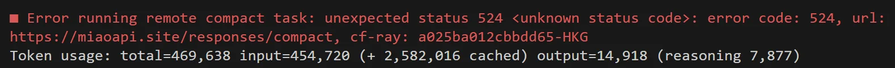
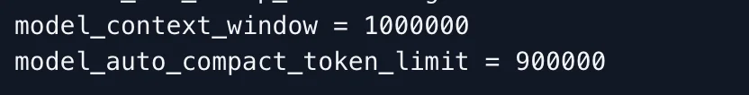
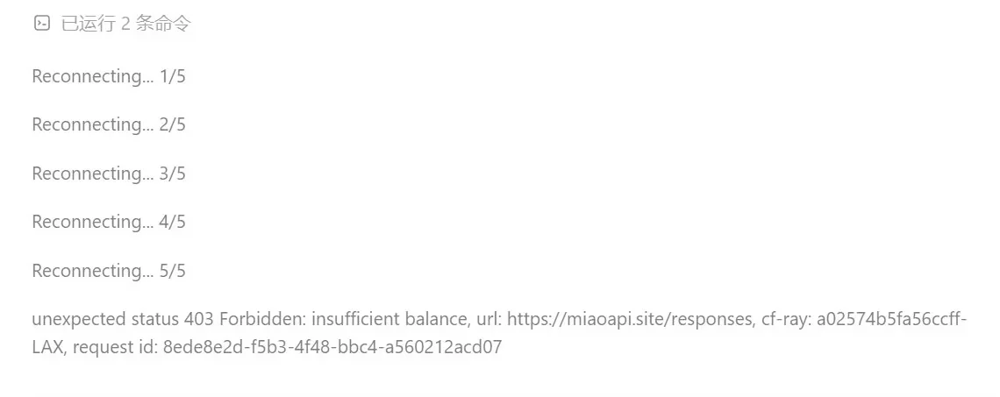
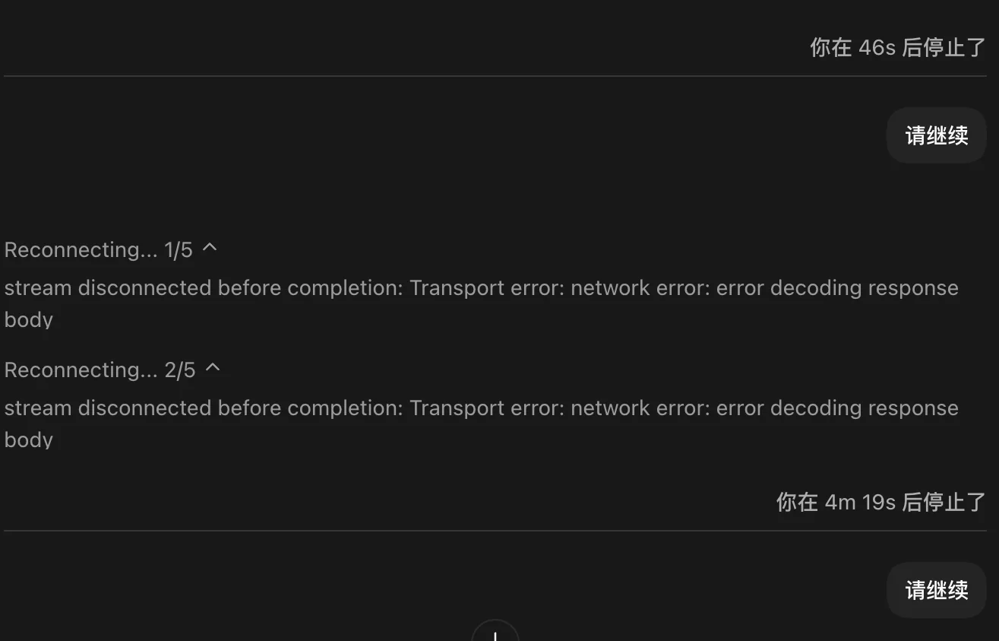

# 常见报错与解决方法

下面整理了使用 MiaoAPI 时可能遇到的常见报错及处理方式。

## Error running remote compact task



出现这个情况大概率是你config.toml中自动压缩的窗口大小设置的不合理

建议改成这样，就不会出现这种问题了



## 403 forbidden



这说明您现在的密钥所在分组下额度不足，如果您刚开通了订阅套餐，请新建一个该订阅分组下的密钥，然后用CC switch切换即可。

## stream disconnected before completion: Upstream request failed



大家可能遇到这种问题，在使用Codex时，会不断提示：

Reconnecting... 1/5

Reconnecting... 2/5

Reconnecting... 3/5

Reconnecting... 4/5

Reconnecting... 5/5

stream disconnected before completion: Upstream request failed

原因其实是Codex 能连上 ChatGPT 后端，但 WebSocket 握手超时。5 次链接后，降级到HTTPS。

---

**为什么使用中转站会一直提示 “Reconnecting 1/5 … 5/5”？**

这既不是你的网络问题，也不是中转站出了故障，而是 Codex 自身的机制导致的。

Codex 启动时，会**优先尝试用 WebSocket** 连接后端。但中转站只提供标准 HTTP 接口，本来就不支持 WebSocket，所以这次握手必然失败。  

Codex 会把这种失败当成普通网络抖动，自动进入重试流程：每次等 15 秒，连试 5 次，凑满 75 秒后才回退到 HTTP。  

这就是你看到的“先卡一分多钟，然后自己又好了”的真正原因。

网上流传的在 `.env` 里写代理的方式，并不能关闭 WebSocket 重试，所以重连问题依旧存在。

**真正有效的解决方法：**

在 `~/.codex/config.toml` 中，将中转站配置为自定义 provider，并显式加上：

```toml
supports_websockets = false
```

这样一来，Codex 会直接从 HTTP 通信，不再走 WebSocket 握手，彻底消除 “Reconnecting” 提示。

也即变成下面这个

```toml
model_provider = "OpenAI"
model = "gpt-5.5"
review_model = "gpt-5.5"
model_reasoning_effort = "xhigh"
disable_response_storage = true
network_access = "enabled"
windows_wsl_setup_acknowledged = true

[model_providers.OpenAI]
name = "OpenAI"
base_url = "https://miaoapi.site/"
wire_api = "responses"
requires_openai_auth = true
supports_websockets = false

[features]
goals = true
```

## 503

这个是号池炸了，请等待修复qwq，抱歉！
